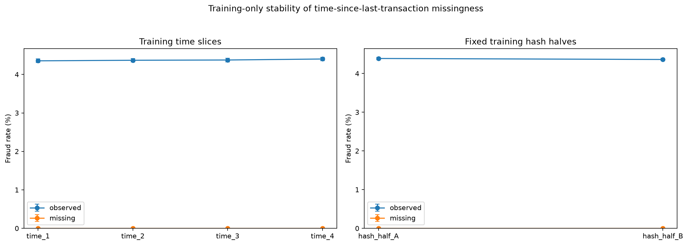
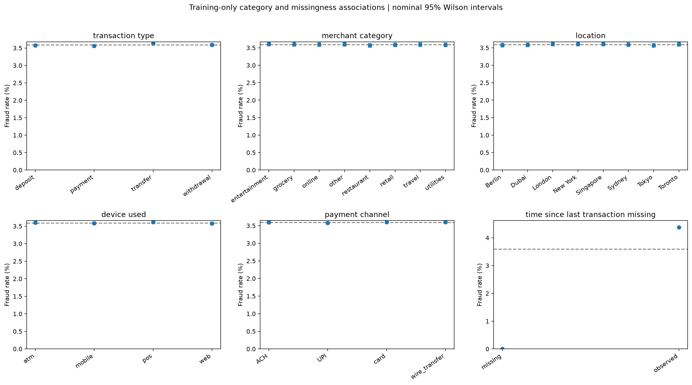
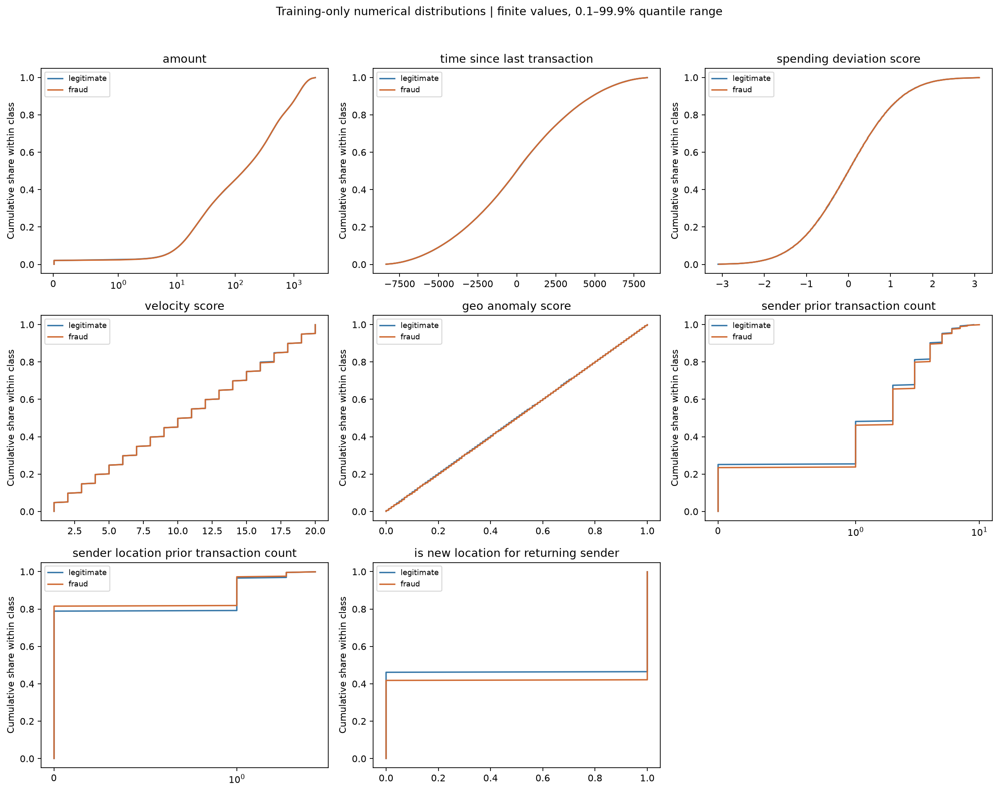
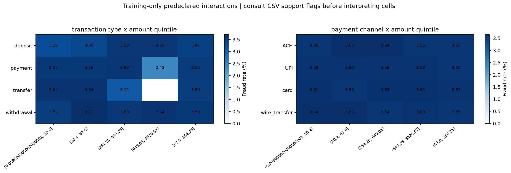

# Training-only predictive-signal diagnostic results

## Status

Implemented, smoke-checked and run on the full frozen training partition on 9 October 2026. Full-data findings are recorded below, separately from the smoke check.

The [plan and run instructions](17_predictive_signal_diagnostics_plan.md) describe methods, examples, source checks and limitations. Stage 17 analyses training rows only; it does not train a classifier, inspect validation/test feature associations, replace the registered model or change the API.

## Interpretation boundary

Earlier full-data EDA observations motivated these checks. The new results below use only frozen training rows; this does not undo the earlier full-data EDA. No mechanism for fraud-label generation or supplied risk-score construction has been verified. Marginal associations and training-slice stability do not establish real-world validity, causality or independent predictive performance.

## Implementation verification

All 109 repository tests passed, including seven Stage 17 tests. Checks cover rate/lift and Wilson arithmetic, association effect sizes, constant/all-missing/binary grouping, malformed inputs, equal-time history exclusion, label-independent history, full-mode split-hash rejection, held-out-feature exclusion in the chunk loader, and generation of all four plots on synthetic data.

No candidate models were fitted for these diagnostics. Other repository tests use small synthetic estimators to verify existing components; they do not repeat the canonical final evaluation.

## Smoke execution

| Item | Recorded value |
| --- | --- |
| MLflow experiment | `financial-fraud-stage-17-training-predictive-signal` |
| Run | `e495312ff9444136ba84af9b4de43bfa` |
| Scope | `training_partition_only`; `smoke_test` |
| Sample partition sizes | Training 35,000; validation 7,500; test 7,500 |
| Training fraud count/rate | 1,257 / 3.5914% |
| Training legitimate count | 33,743 |
| Model fitting / validation or test feature analysis | None |
| Registry / API changes | None |

The retained training sample had no duplicate transaction IDs, repeated selected transaction content, detected conflicting-label groups, negative amounts, invalid numeric text, infinities, or invalid timestamps. This is a sample-level screen only, not a full-data quality conclusion.

### Missingness check in the smoke training sample

| Time-since-last status | Rows | Fraud rows | Fraud rate | Nominal 95% Wilson interval |
| --- | ---: | ---: | ---: | --- |
| Missing | 6,328 | 0 | 0.0000% | 0.0000%–0.0607% |
| Observed | 28,672 | 1,257 | 4.3841% | 4.1531%–4.6272% |

The sample reproduces the earlier missingness association. It does not establish its mechanism, real-world validity, or full-training stability. The outcome-related `fraud_type` field was absent on all 33,743 legitimate sample rows and populated on all 1,257 fraud rows; it remains excluded from predictors, not proposed as a new feature.

### Saved evidence

The run stores `training_predictive_signal_summary.json`, `training_diagnostic_lineage.json`, `dataset_provenance_audit.json`, `library_versions.json`, and `training_predictive_signal_report.md`. CSVs cover group rates, numerical class quantiles, numerical effects, categorical/binned associations and training-slice group rates. The source snapshot records the implementation used by this run.

Four figures are saved under the run's `figures/` artifact folder:

- `categorical_missingness_rates.png`: category and missingness fraud rates with nominal intervals;
- `numerical_class_distributions.png`: finite-value class distribution approximations;
- `bounded_interaction_rates.png`: the two predefined amount/category combinations;
- `missingness_stability.png`: missingness associations across training time slices and hash halves.

These figures were generated successfully; the category/missingness figure was also visually inspected. No transaction-level records or account identifiers were exported. After the run, CSV serialization was given explicit newline delimiters for consistent Windows artifacts; the diagnostic calculations were not changed.

## Full-data execution

| Item | Recorded value |
| --- | --- |
| MLflow run | `8912b6cc67ca47fb8b5f44d66be6ddd8` |
| Experiment | `financial-fraud-stage-17-training-predictive-signal` |
| Analysed rows | 3,500,000 training rows only |
| Fraud / legitimate rows | 125,687 / 3,374,313 |
| Training fraud prevalence | 3.5911% |
| Validation / test feature analysis | None |
| Model fitting / registry / API changes | None |

The raw-source and frozen-split checks passed. The frozen split hash is `e8f58ca7f8c713df27f977c2661f296ea57a118678daebabd79bc4a39c3e9242`; the training-membership hash is `640fa044f95bca464f917fee7e1bbed188b40341d80d86f3280ad1e0fdd315ca`. History was rebuilt from strictly earlier retained training events, without fraud labels.

### 1. Missingness is the clearest association

| Time-since-last status | Rows | Fraud rows | Fraud rate | Nominal 95% Wilson interval |
| --- | ---: | ---: | ---: | --- |
| Missing | 627,581 | 0 | 0.0000% | 0.0000%–0.0006121% |
| Observed | 2,872,419 | 125,687 | 4.3756% | 4.3521%–4.3994% |

All training fraud cases occur in the observed group. Missing values account for 17.93% of training transactions. This is a clear association, but not a strong fraud detector by itself: the observed group still contains 82.07% of all training rows, and about 95.62% of that group is legitimate.

For example, flagging every transaction with an observed value would catch every training fraud case, but would also flag roughly 2.75 million legitimate transactions. This illustrates why high recall can coexist with poor precision; it is not a proposed operating rule.

The missing group contains zero fraud cases in each descriptive stability slice:

| Training slice | Missing rows, all non-fraud | Observed-group fraud rate |
| --- | ---: | ---: |
| Time quarter 1 | 156,706 | 4.3546% |
| Time quarter 2 | 157,859 | 4.3695% |
| Time quarter 3 | 157,457 | 4.3764% |
| Time quarter 4 | 155,559 | 4.4021% |
| Deterministic hash half A | 313,216 | 4.3887% |
| Deterministic hash half B | 314,365 | 4.3626% |

These are training subsets, not independent validation. The intervals are nominal binomial intervals and do not account for repeated-account dependence.

### 2. Most original features show little marginal separation

| Numerical feature | Point-biserial correlation | Quantile-binned total variation |
| --- | ---: | ---: |
| Amount | -0.000156 | 0.004085 |
| Time since last transaction, observed values | -0.000110 | 0.003351 |
| Spending deviation score | -0.000279 | 0.002198 |
| Velocity score | -0.000038 | 0.003159 |
| Geo anomaly score | 0.000276 | 0.002982 |
| Sender prior transaction count | 0.008908 | 0.020817 |
| Sender-location prior transaction count | -0.013023 | 0.027664 |
| New location for returning sender | 0.015708 | 0.042078 |

These calculations use finite values. In particular, the time-since numerical row excludes missingness, which is informative separately. Total variation here compares class distributions over training-derived bins; it is not a complete measure of all possible predictive information.

Original categorical associations are also small: Cramér's V is 0.001424 for transaction type, 0.000662 for merchant category, 0.000797 for location, 0.000832 for device and 0.000493 for payment channel. The binary time-missingness indicator has V = 0.090212, larger than these associations.

The results are consistent with limited readily available separation in the original inputs. They do not prove that useful nonlinear or untested joint patterns are absent.

### 3. Behavioural features have modest associations

Fraud rates are 3.2746% when the new-location-for-returning-sender flag is 0 and 3.8610% when it is 1: a difference of 0.5864 percentage points. The groups contain 1,611,049 and 1,888,951 rows respectively, so this is not just a tiny-group observation. Its effect size remains small.

This supports retaining the behavioural features for investigation and is consistent with the earlier controlled feature comparison. It does not independently measure their model improvement or establish that they solve the weak predictive performance.

### 4. The two bounded interaction checks show weak overall associations

Transaction type × amount quintile has Cramér's V = 0.002680; payment channel × amount quintile has V = 0.001906. Neither reveals a strong overall association in this screen.

Some individual cells have limited support. For example, the payment/highest-amount cell has 1,317 rows and 32 fraud cases, while one transfer/amount cell has only 128 rows and four fraud cases. Differences in such cells should not be treated as robust new rules. Only two predefined interactions were examined; this is not an exhaustive search.

### 5. Quality checks pass, but feature meaning remains unresolved

The audited training rows contain no duplicate IDs, repeated selected transaction content, detected conflicting-label groups, invalid numeric text, infinities, negative amounts or invalid timestamps. These checks do not establish that every field is semantically valid.

In particular, `time_since_last_transaction` includes values from approximately **-8,759.57 to 8,753.47**. Negative values under an elapsed-time name warrant checking the field's definition and units. They have not been automatically corrected or declared the cause of poor model performance.

`fraud_type` is populated on all 125,687 fraud rows and missing on all 3,374,313 legitimate rows. It remains excluded as outcome-related information, not added as a predictor.

The dataset was subsequently confirmed as Aryan208's Kaggle financial-transactions dataset. Its generation process, fraud-label definition and derivation of the supplied risk scores remain unverified. The missingness association may reflect how the synthetic data were constructed; the diagnostic cannot determine that mechanism.

### Evidence and next decision

The full run contains the same aggregate JSON, CSV, report, figures and source-snapshot artifact types listed above. The four images embedded here are unchanged copies of its figure artifacts; [figure provenance](images/17_predictive_signal/figure_sources.json) records their source run and checksums. No transaction-level records were copied into the documentation.

The [source and field-definition follow-up](17_dataset_source_and_field_audit.md) records the source confirmation and a published example with negative elapsed-time values. Field semantics, generator details and label rules remain unresolved. The evidence does not justify another broad model search or a claim that the dataset has no predictive signal. Any subsequent missingness/feature sensitivity experiment needs an explicit design; none was run here.

Registered version 1, the current API, the frozen operating rule and the completed final test evaluation remain unchanged. The consumed test set must not become a tuning resource.
