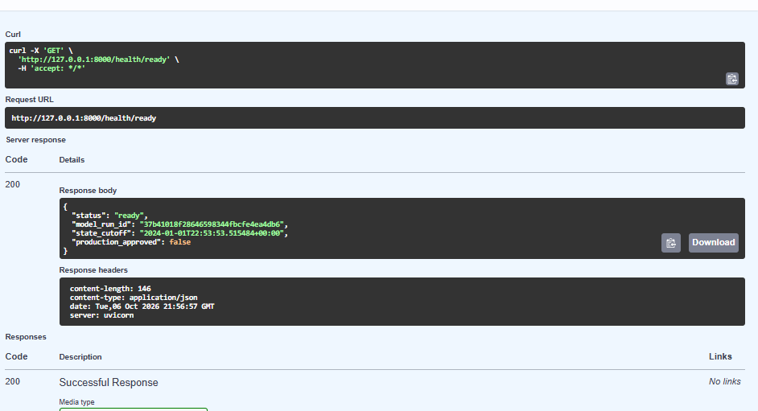
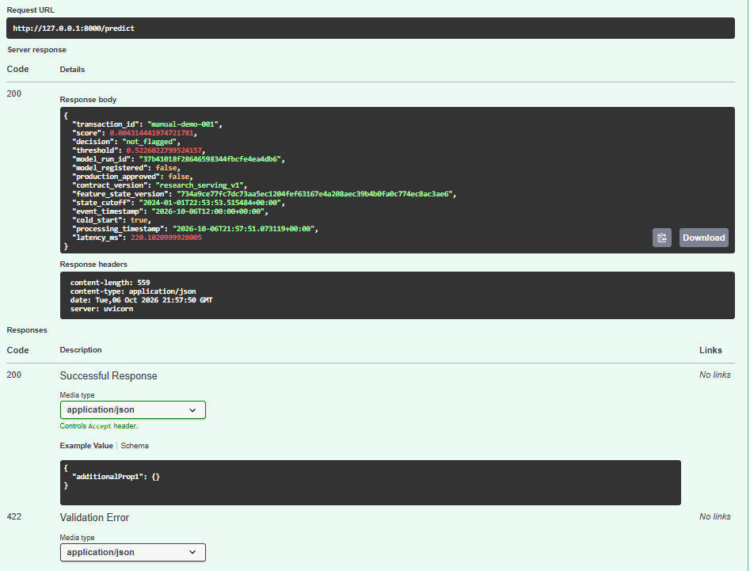

# Research prediction API: implementation and verification

## Status

Implemented and checked locally on 6 October 2026. Future-online serving against the frozen training state is working. The exact Stage 14 pipeline is reused; no model was retrained, registered, promoted or evaluated again on the final test partition.

Checks used temporary synthetic stores and in-process FastAPI HTTP requests. No continuously running server was left behind. The canonical Feast files were not materialised or modified by the serving preparation.

## Verified full-size serving bundle

| Item | Recorded value |
| --- | --- |
| Evaluated model run | `37b41018f28646598344fbcfe4ea4db6` |
| Contract | `research_serving_v1` |
| Source population | Frozen 3,500,000 training transactions |
| Expected latest sender entities | 892,006 |
| Expected latest sender-location entities | 3,208,923 |
| Latest effective snapshot cutoff | `2024-01-01T22:53:53.515484+00:00` |
| Primary research threshold | `0.5226022799524157` |
| Registry / production approval | Neither performed |

The source tables contain multiple historical snapshots per entity, so these latest entity counts are smaller than the snapshot-row totals documented in Stage 09. Full source hashes, model schema, library versions and copied online row counts were verified. Future-online queries are accepted only after the recorded cutoff.

## Synthetic checks

Twelve serving tests cover request validation and timezone conversion, exact model-input order, missing numeric values, cold starts, new locations, invalid counts, label/history injection, duplicate IDs, conflicting requests, store outages and rejection of historical online requests.

The complete repository suite passed: 93 tests, including the 12 new serving tests. It was run from `Code snippets`; a thesis-root invocation initially failed two existing repository-relative path checks, so the documented full-suite command now enters the repository first. The framework emits a non-failing deprecation warning about its HTTP test-client dependency; no unrelated framework upgrade was performed.

The synthetic snapshot index matched the directly calculated training history and excluded validation/test contributions. Equal-time training events saw no same-time history. A real temporary Feast store returned the expected `(2, 2)` counts for a known pair, `(2, 0)` for a new pair and `(0, 0)` for an unseen sender. Historical retrieval at the tied first event returned zero. Removing a synthetic known-state row caused failure rather than a zero default. No canonical store rows were removed.

These are technical verification results, not additional predictive-performance experiments. Broad historical training/validation replay parity and a historical replay endpoint remain outstanding.

## Invented request through the saved model

Two invented future transactions with an unseen example sender were sent through the in-process API. Both used amount `120.0`, an explicit null time-since-last-transaction field and example categorical values. No fraud label was supplied.

| Check | Result |
| --- | --- |
| Readiness endpoint | HTTP 200 |
| Prediction endpoint | HTTP 200 |
| Retrieved history | Sender 0, sender-location 0, new-location flag 0 |
| Score | `0.004314441974721781` |
| Decision | `not_flagged` at the unchanged research threshold |
| Cold start | True |
| Direct saved-pipeline score versus API score | Exact equality for the second request |
| Versioned request/feature/response logging | Persisted in the ignored local SQLite ledger |

The first request took approximately 1,973 ms while readiness rescanned full-state membership. After moving those full scans to startup and keeping immutable-file checks plus health probes per request, the second request recorded approximately 76.64 ms. These are two local technical observations under different implementation conditions, not a controlled latency benchmark or a production SLA. Startup still performs full integrity checks.

The score above is not a fraud probability estimate validated for this invented transaction. It only demonstrates that the model loads, features can be assembled, and the interface returns and records the unchanged decision rule. It does not improve or replace Stage 14's weak predictive results.

## Manual browser verification

On 6 October 2026, the local Uvicorn server was started and checked through Swagger at `http://127.0.0.1:8000/docs`. The screenshots supplied from the browser show HTTP 200 and `status: ready` for `/health/ready`, followed by a successful `/predict` request for invented transaction `manual-demo-001`.

Figure 1. The readiness check confirms that the evaluated research model and frozen feature state are available. Production approval remains false.

Figure 2. The API returns the score, unchanged threshold, decision and model/state references for an invented transaction. This is a serving check, not evidence of fraud-detection accuracy.

| Observed response field | Value |
| --- | --- |
| HTTP status | 200 |
| Score | `0.004314441974721781` |
| Decision | `not_flagged` |
| Threshold | `0.5226022799524157` |
| Cold start | True |
| Model registered / production approved | False / False |
| Reported processing latency | Approximately 220.10 ms |

The manual request supplied the example account, Berlin location, amount `120.0` and the prepared example predictors from the feature contract. Its score matches the earlier technical demonstration. This confirms browser-to-server request handling and a versioned model response; it does not establish genuine transaction legitimacy, fraud-detection quality or a latency benchmark. The listed HTTP 422 validation response below the successful Swagger response is schema documentation, not evidence that this request failed.

## Remaining boundaries

- Local, unauthenticated, single-worker prototype only; not deployed publicly.
- Frozen latest training history only; requests do not advance behavioural state.
- Original upstream score features are supplied by the caller; their live computation is not implemented.
- The serving ledger is persistent and private; automated retention and access controls remain unimplemented.
- MLflow Registry integration, delayed-label monitoring, investigation rules, Streamlit and Docker remain pending.
- Final test evidence remains closed to further tuning or repeated evaluation.

Research-model registration subsequently completed on 8 October 2026: [Stage 16 registration](16_research_model_registration.md) records version 1 and its exact source checksum. The Stage 15 API still uses the existing exported bundle, and its recorded `model_registered=false` field is historical bundle metadata, not the status of the separate later registry record. The next serving implementation is registry-to-API provenance with an explicitly pinned research version; no production champion has been declared.
